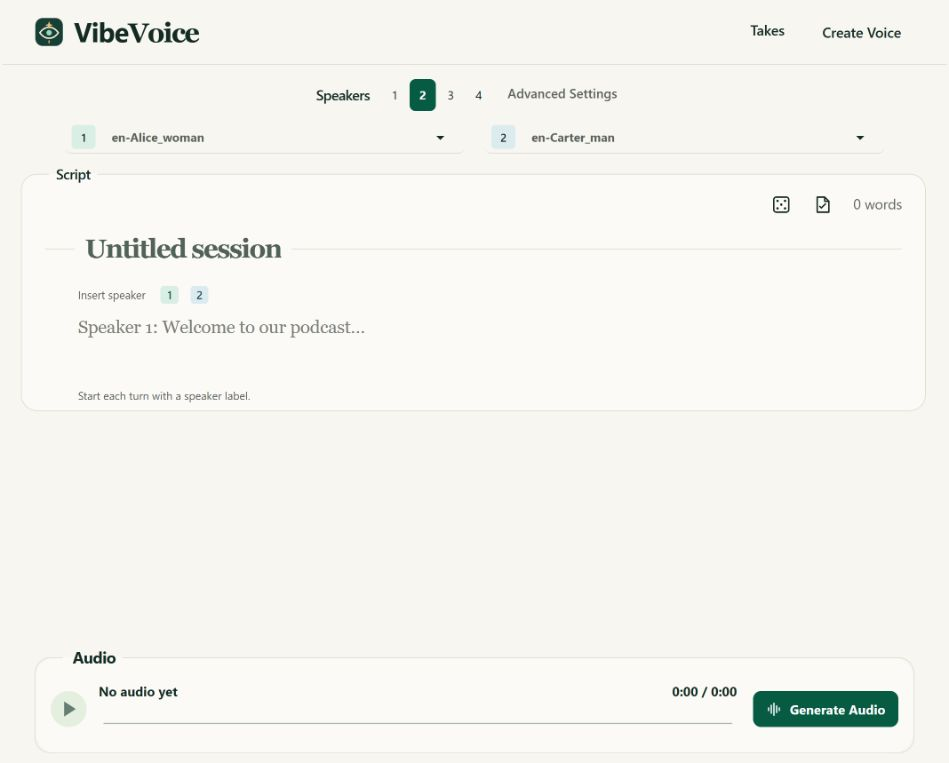
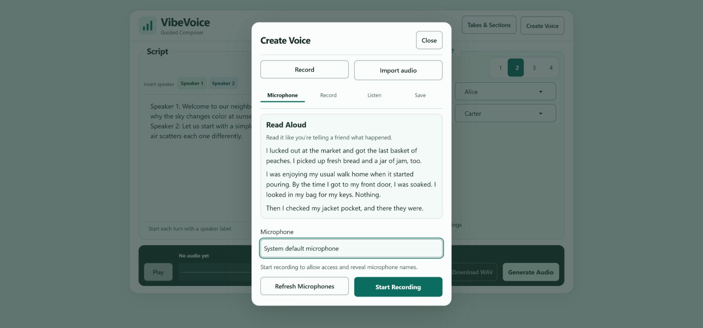

# VibeVoice Pro

**Write a conversation. Choose the voices. Listen, refine, and save.**

VibeVoice Pro is a local, browser-based workspace for creating spoken audio from text with the VibeVoice models. Its Writing Studio brings the script, up to four speakers, and playback into one view.

This is an independent community fork, not an official Microsoft product or hosted voice service. It builds on [VibeVoice Community](https://github.com/vibevoice-community/VibeVoice) and Microsoft's original VibeVoice research and implementation.



[See the compact layout](docs/images/writing-studio-compact.jpg) · [Read the Writing Studio guide](docs/WRITING-STUDIO.md)

## Where this fork fits

**Microsoft built the speech technology. VibeVoice Community preserved and extended the original long-form TTS code. VibeVoice Pro builds a more usable local creation workspace on that foundation.**

### How the project reached this point

- **Original research:** Microsoft released VibeVoice-TTS for long-form, multi-speaker speech. Voice conditioning from reference audio, the speech model, and its generation capabilities are inherited technology, not inventions of this fork.
- **Community continuation:** Microsoft's September 5, 2025 statement says it removed the original VibeVoice-TTS code after discovering uses inconsistent with its stated intent. The community repository records a September 4 backup and continued access to that code, alongside unofficial fine-tuning work. This describes the documented history, not a claim about anyone's motives.
- **Microsoft's project continues:** the official repository now also covers realtime speech and speech recognition. It is **not accurate to say that all of VibeVoice remains removed**. Those newer official capabilities should not be confused with features integrated into this composer.
- **This fork:** VibeVoice Pro branches from the community revision [`952326d`](https://github.com/vibevoice-community/VibeVoice/commit/952326ddb264062466a888cf32a5b2f4e803e16e). Its changes focus on the demo application, playback, local voice/take management, and tests. The inherited `vibevoice/` model implementation, training code, and dependency file are unchanged from that baseline. We do not claim a new model, better model accuracy, or new training results.

### What is inherited, and what is different?

| Area | Inherited foundation | VibeVoice Pro's changes |
| --- | --- | --- |
| Speech generation | Long-form TTS, up to four speakers, reference-voice conditioning | A responsive Writing Studio, clearer speaker assignment, script checks, and reversible example cycling |
| Listening | The community demo already streamed generated audio and had a stop control | Separate listening from generation; carry playback position and pause state into the finished WAV; protect against duplicate requests |
| Voice references | Existing model support for reference audio and bundled voice samples | A guided microphone recorder and WAV-range import; saved voices are separate from protected built-in presets |
| Completed work | Generated audio output | A local Saved Takes library and optional section retry/export workflow |
| Reliability and setup | Community inference, device support, and setup | Windows launcher, session-focused checks, stream-polling fixes, and Python/JavaScript regression tests |
| Training and other models | Community fine-tuning and additional model tools | Retained technical references, **not** newly integrated training or ASR features in the composer |

“Pro” is this fork's name, not a paid tier or a promise of production readiness. The goal is a clearer create/listen/refine workflow, not ownership of the underlying research. See [current limits](#current-limits) before relying on it.

**Primary sources:** [Microsoft's release/removal statement and current project](https://github.com/microsoft/VibeVoice/blob/16fb2cb1217c9934a886e1948ffb06120caa2df5/README.md), [the community history and credits at our baseline](https://github.com/vibevoice-community/VibeVoice/blob/952326ddb264062466a888cf32a5b2f4e803e16e/README.md), and [this fork's changes through the transparent-heading update](https://github.com/Sczitzo/VibeVoice-Pro/compare/952326d...cfcd503). The historical upstream README is also preserved [locally](docs/UPSTREAM_README.md); its dated removal notices are historical, not a description of every official offering today.

## What you can do

- **Write for 1–4 speakers.** Assign voices, insert speaker labels, and check the script before generating. The editor grows with your script until it reaches the window limit, then scrolls inside the editor.
- **Try an example without losing your draft.** Random Example cycles through examples. Undo restores earlier script changes, including overwritten drafts; keyboard undo and redo work too.
- **Listen as audio is generated.** Pause listening without stopping generation. When the final WAV is ready, playback carries over your position and playing or paused state.
- **Stop and try again.** Stop cancels the active generation. Rejected or cancelled attempts preserve the previous completed take.
- **Create a voice.** Record with your microphone, review the take, name it, and add it to the voice library. Or import a WAV and select the range to use.
- **Keep completed work.** Use **Takes & Sections** to name, save, preview, and download completed takes.
- **Recover long scripts in sections.** The optional section-generation preview lets you retry unfinished sections and export a complete WAV once every section is ready.



*Screenshots show the current interface with fictional example content and generic voice labels.*

## Quickstart (Windows)

You need **Git**, **Python 3.11**, and enough disk space for dependencies and model files. A compatible GPU is recommended; CPU generation can be slow. The first launch downloads the selected model from Hugging Face. The default 1.5B model download is approximately 5.4 GB, in addition to the Python packages.

In PowerShell:

```powershell
git clone https://github.com/Sczitzo/VibeVoice-Pro.git
cd VibeVoice-Pro
py -3.11 -m venv .venv
.\.venv\Scripts\python.exe -m pip install --upgrade pip
.\.venv\Scripts\python.exe -m pip install -e .
.\.venv\Scripts\python.exe -X utf8 demo\gradio_demo.py --model_path vibevoice/VibeVoice-1.5B --port 7861
```

For GPU acceleration, install the PyTorch build appropriate for your GPU and drivers in this same environment using the [official PyTorch instructions](https://pytorch.org/get-started/locally/). The app chooses CUDA, MPS, or CPU according to what PyTorch reports as available. Installation and speed vary by computer; this is not a one-click packaged installer.

Open **http://127.0.0.1:7861** if the browser does not open automatically. Keep the terminal open while using the app. Press **Ctrl+C** in that terminal to stop the server.

After setup, you can double-click **Start-VibeVoice.cmd** in the project folder. It uses the same local environment, model, and port. The commands above do **not** enable public sharing.

On Linux/macOS, create a Python 3.11 virtual environment, install the editable package, and run the same demo command with that environment's Python. The included `.cmd` launcher is Windows-only. See the [upstream technical reference](docs/UPSTREAM_README.md) for other models, command-line inference, and advanced setup.

## Make your first take

1. Choose the number of speakers and assign each a voice.
2. Write your script with a label at the start of each turn:

   ```text
   Speaker 1: Welcome! Today we are trying something new.
   Speaker 2: Let's hear how it sounds.
   ```

3. Click **Check Script**, then **Generate Audio**.
4. Use **Play/Pause** to control listening. **Stop Generation** is separate: it stops creating audio. Do not start another generation until the current one finishes.
5. Listen to the final result. Edit the script and generate again if needed.
6. Download the WAV, or open **Takes & Sections** to name and save the completed take.

**Undo:** the Undo button appears after a script change. Use Ctrl+Z on Windows or Cmd+Z on macOS; Ctrl/Cmd+Shift+Z redoes a change. History belongs to the current page session, not a saved document. Copy important scripts somewhere safe before closing or refreshing the page.

### Add your own voice

Open **Create Voice**, choose your microphone, and record the reading prompt. Allow browser microphone access when you are ready. Stop, listen, and save with a new name. A saved voice appears in the speaker lists; saving it does not change your existing speaker assignments.

For **Import audio**, choose a mono or stereo WAV no longer than **60 seconds** and no larger than **32 MiB**. Select the start and end of the range, preview it, then name and save the voice. Use clean speech with minimal background noise. Only use recordings you have permission to use.

Saved voices appear directly in the speaker picker. Expand **Built-in presets** to see the samples that ship with the app; those cannot be deleted. To remove a saved voice, use its actions menu. The list updates without reloading the page, and the removal notice offers **Undo**.

### Generate in sections (preview)

Enable **Generate in sections (preview)** in Advanced Settings. Separate script sections with a line containing `---`, and use speaker labels inside each section. Open **Takes & Sections** to see progress, preview finished sections, retry failed or stopped ones, and export the full WAV. Section recovery is tied to the current session; save or download completed output before closing the app.

## Privacy and responsible use

- The normal launch binds to your computer's local address. Audio processing runs in the local application; downloading dependencies and models requires internet access. Upstream libraries may perform their own update or telemetry checks. Local launch is not a guarantee of zero network traffic.
- Recorded/imported voices are stored under `demo/voices/recorded/`, which is excluded from Git. Completed takes are stored outside the repository: `%LOCALAPPDATA%\VibeVoicePro\Takes` on Windows, or `~/.local/share/VibeVoicePro/Takes` otherwise. The app also creates temporary audio/cache files.
- Git exclusions are not encryption, deletion, or a backup. Protect your computer and review files before publishing. Do not commit personal recordings, generated private audio, credentials, or local logs.
- Public sharing is optional and is **not** the quickstart default. The app disables private recording/import, saved-take, and section tools in shared mode. Do not treat a shared demo as a secure multi-user service or expose sensitive scripts.
- Use a person's voice only with their permission. Do not impersonate people deceptively, create fraudulent audio, or represent generated speech as an authentic recording. Clearly disclose synthetic audio where appropriate.

## Current limits

This is an evolving research-based application, not a production service with guaranteed output quality or uptime.

- Generation speed and memory use depend on the model, hardware, and script. Start short. Very long runs can reach model limits or fail; section recovery does not guarantee seamless joins.
- Pronunciation, timing, voice similarity, and unwanted sounds can vary. Always listen before publishing. Cross-language quality is not guaranteed.
- A saved voice sample is a reference for generation, not a newly trained model.
- Browser microphone permission and physical-device recording quality must be checked on your own computer. Automated tests cannot establish whether a voice sounds right.
- Audio import currently accepts WAV, not arbitrary music/video formats. Advanced training and the separate upstream realtime model are not part of the Guided Composer's everyday workflow.
- Unsaved scripts, editor history, and unfinished section jobs are not durable projects. Save or download what you need before restarting.

## Technical reference and contributing

- [Inherited upstream documentation and model links](docs/UPSTREAM_README.md)
- [Fine-tuning guide](FINETUNING.md) (experimental)
- [Upstream audio examples](EXAMPLES.md)
- [Automated tests](tests/)

Keep new work compatible with the pinned dependencies in `pyproject.toml`. For local Python checks, run `python -m unittest discover -s tests -v` with the project's environment. The JavaScript regression tests use Node's built-in test runner and are in `tests/*_js.cjs`. Passing automated checks does not replace browser testing and listening to real output.

## Credits and license

Thanks to **Microsoft** for the original VibeVoice model and implementation, **VibeVoice Community** for maintaining the community codebase, **Juan Pablo Gallego / VoicePowered AI** for the unofficial fine-tuning implementation, and **PsiPi** for shared emotion-control experiments. The [archived upstream README](docs/UPSTREAM_README.md#credits) retains the original credits and notices.

Repository code is provided under the [MIT License](LICENSE), including Microsoft's original copyright notice. Consult each model's own card and distribution terms before downloading or using its weights. This fork does not claim Microsoft endorsement.
